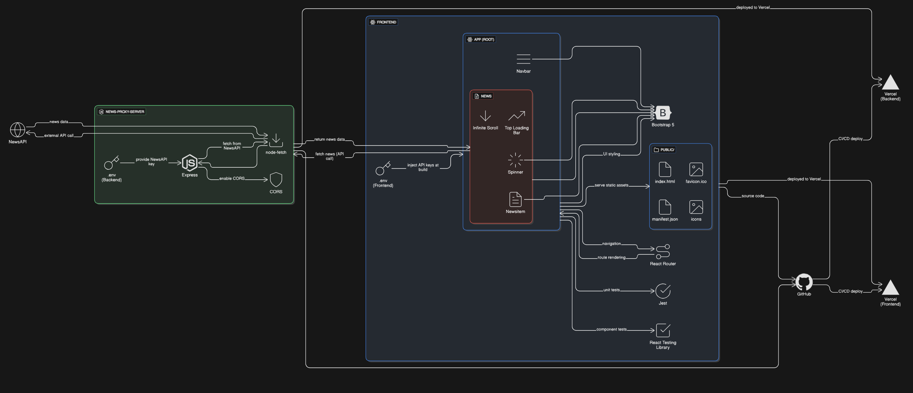

# 📰 NewsMonkey - React News App

**NewsMonkey** is a modern React-based web application that delivers up-to-date news articles from various categories using the [NewsAPI](https://newsapi.org). It features infinite scrolling, category-wise navigation, loading indicators, and a clean UI — designed to offer users a seamless reading experience.

## ⚙️ Features

- 🧠 News from multiple categories: General, Business, Entertainment, Health, Science, Sports, Technology
- 🔄 Infinite Scroll to load more articles on scroll
- ⚡ Fast performance and smooth transitions
- 📱 Fully responsive design
- 📦 Fetching articles via **NewsAPI**

## 🛠️ Tech Stack

- **React JS**
- **React Router**
- **Bootstrap 5**
- **NewsAPI**
- **Vercel** for deployment

## Architecture Diagram



## 📁 Folder Structure (Simplified)

```
NewsMonkey/
├── public/
│   └── index.html
├── src/
│   ├── components/
│   │   ├── Navbar.js
│   │   ├── News.js
│   │   ├── NewsItem.js
│   │   └── Spinner.js
│   ├── App.js
│   ├── App.css
│   └── index.js
├── .env                # API key configuration (optional)
├── package.json
└── README.md
```

## 🚀 Getting Started

### 1. Clone the repo

```bash
git clone https://github.com/Reet-Kamlay/NewsMonkey.git
cd NewsMonkey
```

### 2. Install dependencies

```bash
npm install
```

### 3. Setup API Key

Create a `.env` file in the root directory and add your [NewsAPI](https://newsapi.org) key:

```
REACT_APP_NEWS_API=your_api_key_here
```

### 4. Start the development server

```bash
npm start
```

Open `http://localhost:3000` to view the app.

## 🧑‍💻 Author

**Reet Kamlay**  
GitHub: [@Reet-Kamlay](https://github.com/Reet-Kamlay)

---

> This project is built for learning purposes and showcases use of APIs, infinite scroll, component-based architecture, and responsive design using React.
